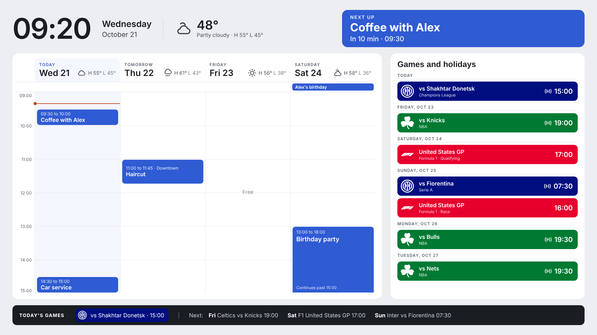
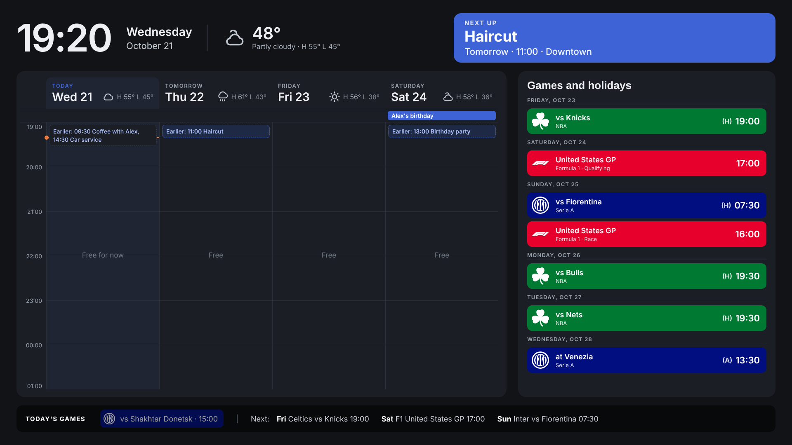
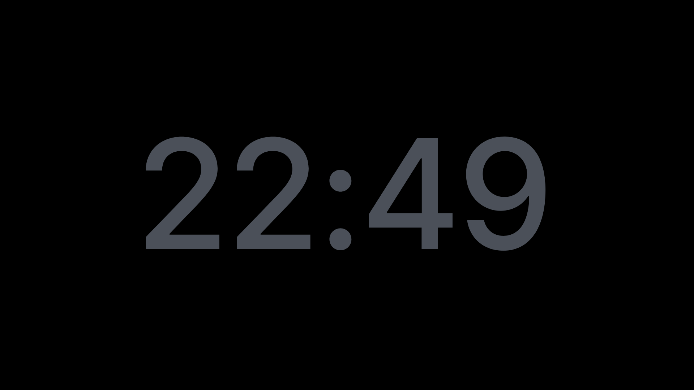
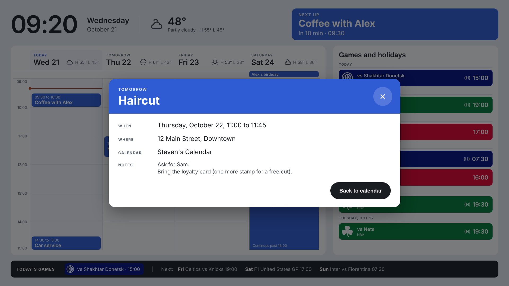
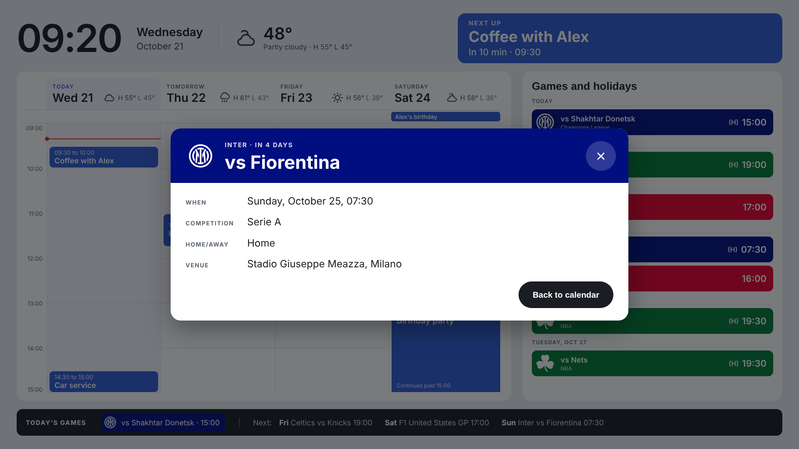

# Digital Calendar Frame

A wall and counter calendar built from a cheap Frameo photo frame. It puts my own plans first, with my teams' games in their own colors and logos off to the side, live weather, a dark mode at sunset and a dim night clock.

The full build story is on my site: [A photo frame turned counter calendar](https://www.stevenmerickson.com/workshop/counter-calendar/).



## What's in here

| Folder | What it is |
|---|---|
| [`apps-script/`](apps-script) | The dashboard: a Google Apps Script web app. `Code.gs` reads your calendars, the weather and your team logos; `Index.html` is the screen. |
| [`frame/`](frame) | Scripts that run on the frame itself: the night backlight dimmer and the startup file that launches it. |

## How it works

- **The screen** is one web page, shown full screen by [Fully Kiosk Browser](https://www.fully-kiosk.com/) (free version) on the frame.
- **The page** runs on Google Apps Script, inside your own Google account. It reads your calendars directly, gets the weather from [Open-Meteo](https://open-meteo.com/) (free, no account), and loads team logos from a Google Drive folder. It refreshes every 5 minutes.
- **Your plans** sit on a 4 day time grid showing 6 hours from the current hour. Anything outside the window shows as an "Earlier" or "Later" tag.
- **Games** show in team colors with logos, home or away, and never the score.
- **Tap anything** for its details: time, place, notes, venue, competition.
- **After sunset** it switches to dark mode. From 21:00 to 6:30, two minutes without a touch shows a gray clock, and the backlight script on the frame dims the screen.

| Dark mode | Night clock |
|---|---|
|  |  |

| Event details | Game details |
|---|---|
|  |  |

All appointments in these screenshots are placeholders.

## Setting up the dashboard

1. Go to [script.google.com](https://script.google.com), create a new project, and paste in [`apps-script/Code.gs`](apps-script/Code.gs).
2. Add an HTML file named exactly `Index` and paste in [`apps-script/Index.html`](apps-script/Index.html).
3. Edit the `CONFIG` block at the top of `Code.gs`: your calendars, your teams and their colors, your location for the weather, and your logo folder.
4. **Logos:** make a Google Drive folder, add one file per team named by its code (for example `CEL.svg`), and put the folder's ID in `logoFolderId`. White, one-color logos look best on the colored blocks; logos with color get a white circle behind them. (Logos aren't included here, since they belong to the teams.)
5. Choose `testRun` in the function menu and click **Run**. Approve access to Calendar, Drive and external requests (tick every box on the permission screen). The log shows what it found.
6. **Deploy > New deployment > Web app**, execute as **Me**, access **Anyone**, and copy the `/exec` link. Treat the link like a password: anyone with it can see your schedule.
7. Open the link with `?check=1` on the end to confirm the deployment and the logos it can see.

Display settings (the hours shown, night clock hours, dimming) are at the top of the script in `Index.html`. After changing a logo, run `clearCache` from the editor and reload the frame. After changing the code, deploy a **New version** of the same deployment so the link stays the same.

## Setting up the frame

I used a 15.6 inch Pastigio Frameo frame (reports itself as FRAME156, Android 8.1, Rockchip RK3326, 1920 x 1080). Other frames will differ.

The unlocking approach comes from Wes Bos and Syntax: [photo-frame-dashboard](https://github.com/wesbos/photo-frame-dashboard) and the video [Jailbreaking a $50 photo frame](https://www.youtube.com/watch?v=ZLycoUMltNI). Read it first. In short, for my frame:

1. Turn on **ADB Access** in Frameo's beta program settings and connect from a computer with [Android platform tools](https://developer.android.com/tools/releases/platform-tools). Mine connected without a prompt and shipped with root (`adb shell su -c id`).
2. Switch off the update apps so an update can't undo anything (package names on my frame):
   ```
   adb shell su -c "pm disable com.muxintu.app.mxota"
   adb shell su -c "pm disable android.rockchip.update.service"
   ```
3. Install Fully Kiosk Browser, set the dashboard link as the Start URL, and turn on **Launch on Boot** and **Keep Screen On**.
4. Switch off Frameo and Android's status bar app (it crashed once Frameo was gone):
   ```
   adb shell su -c "pm disable net.frameo.frame"
   adb shell su -c "pm disable com.android.systemui"
   ```

Every change here can be undone with `pm enable` and the same name.

## The night backlight script

A dark page still glows, because the backlight stays on. [`frame/calendar-dimmer.sh`](frame/calendar-dimmer.sh) runs on the frame as root: between 21:00 and 6:30 it dims the backlight after 2 minutes without a touch, and brings it back on the next touch. It reads the touchscreen and backlight paths for my frame, so check yours with `adb shell getevent -p` and `ls /sys/class/backlight/`.

It starts at boot through [Termux:Boot](https://f-droid.org/packages/com.termux.boot/) (with [Termux](https://f-droid.org/packages/com.termux/), both from F-Droid), using [`frame/start-dimmer`](frame/start-dimmer), which also reopens Fully in case its own Launch on Boot doesn't fire. On Windows, quote commands like this so the redirect runs as root:

```
adb push calendar-dimmer.sh /data/local/tmp/
adb shell chmod 755 /data/local/tmp/calendar-dimmer.sh
adb shell "su -c 'nohup /data/local/tmp/calendar-dimmer.sh >/dev/null 2>&1 &'"
```

Two things that tripped me up: Termux starts scripts with its own `PATH` (the script sets Android's), and this frame's `timeout` reports a time out as exit code 142 instead of 124 (the script accepts both).

## Power

The frame runs on 12V through a 4.0 x 1.35 mm barrel plug (a rare size). I powered it from a USB-C charger that lists 12V output, through a homemade cable: a USB-C PD trigger board (HW-398, set to 12V by bridging its 12V pad) soldered to the plug cut from the original adapter. Check for +12V on the center pin with a multimeter before connecting the frame.

## License

[MIT](LICENSE). Use it, change it, make it yours.

---

*Built with Claude as my build partner: the mockups, the dashboard code and the frame scripts. I made the calls and tested everything on the frame.*
